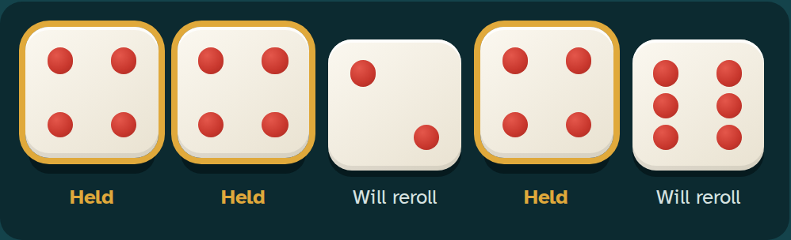
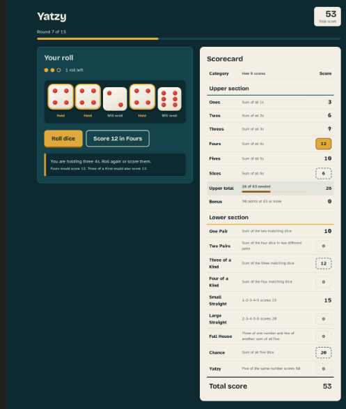
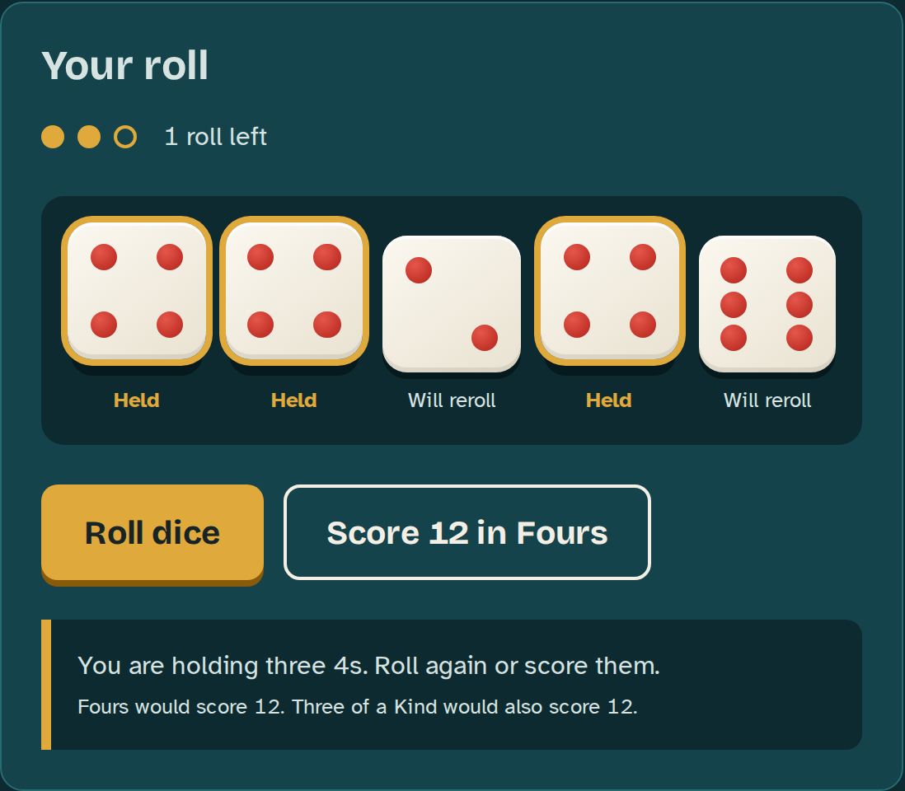
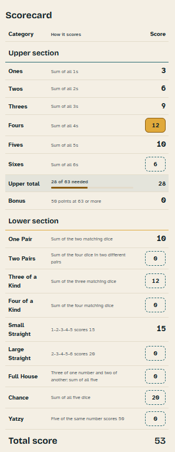
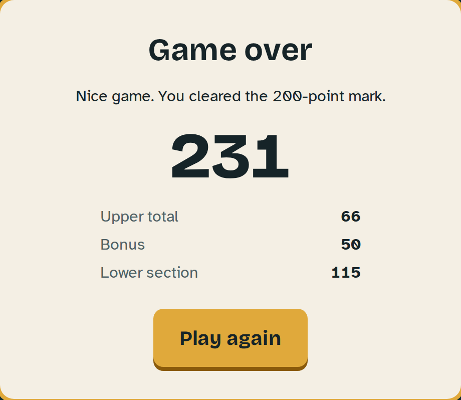
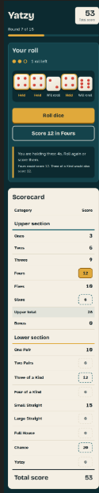

# Yatzy: Node.js + Express Edition 

The Yatzy game now has a **server**. The server owns the game state, rolls the dice, calculates scores and tracks round progress. The browser only draws the UI and sends player actions with the **Fetch API**

| Before (client only) | After (client + server) |
| --- | --- |
| `dice.js`, `yatzy_engine.js`, `yatzy_game.js` ran in the browser | Same files now run in Node under `game/` |
| `main.js` called `game.rollDice()` directly | `main.js` calls `fetch('/api/games/:id/roll')` |
| State lived in JS variables on the page | State lives in a `Map` on the server, one entry per game |

## 1. Project structure

```
assignment2/
├── server.js            Express app + REST API routes
├── package.json         dependencies and npm scripts
├── game/                game logic (server side)
│   ├── dice.js          rolling and holding dice
│   ├── yatzy_engine.js  scoring rules and score table
│   └── yatzy_game.js    rounds, rolls per turn, game over, best score
├── public/              client (served statically by Express)
│   ├── index.html
│   ├── style.css
│   └── main.js          UI + Fetch API calls
```
## 2. Server setup

Requires **Node.js**

```bash
cd assignment2
npm install        # installs Express
npm start          # runs node server.js
```

Open **http://localhost:3000**. 

| Script | What it does |
| --- | --- |
| `npm start` | Start the server |

## 3. How it works 

1. On page load the client sends `POST /api/games`. The server creates a game and returns its `id` plus the full state 
2. The client keeps the `id` in `sessionStorage`, so a refresh resumes the same game (`GET /api/games/:id`).
3. Every action (roll, hold, score) is a request. The server validates it against the rules, changes the game, and replies with the new state 
4. the client redraws everything from that state. It contains **no rules**. Even the "would score" numbers on the scorecard come from the server (`potentialScores`).
5. Games idle for 2 hours are removed from server memory. if the server restarts, the client gets a 404 and starts a fresh game automatically.

## 4. API reference

Base URL: `http://localhost:3000`. All bodies and responses are JSON

| Method || Endpoint | Body | Purpose | Success |
| --- | --- | --- | --- | --- |
| `POST` | `/api/games` | none | | Create a new game | `201` + state |
| `GET` | `/api/games/:id` | none | Read current state | `200` + state |
| `POST` | `/api/games/:id/roll` | none | Roll all dice that are not held | `200` + state |
| `PUT` | `/api/games/:id/dice/:index/hold` | `{ "held": true }` | Hold or release die `0` to `4` | `200` + state |
| `POST` | `/api/games/:id/score` | `{ "category": "fullHouse" }` | Lock the current dice into category | `200` + state + `scored` |
| `PUT` | `/api/games/:id/restart` | none | restart the game, keeping the best score | `200` + state |
| `DELETE` | `/api/games/:id` | none | Delete the game | `204` |

### why these methods 
- `POST` is for actions that change state and are **not** repeatable (a roll gives new random dice every time, scoring locks a category).
- `PUT` is for setting something to a known value, so repeating it is harmless (`held: true` twice is the same as once, restart always gives the same fresh game).
- `GET` only reads. `DELETE` removes the game

### Category names

`ones`, `twos`, `threes`, `fours`, `fives`, `sixes`, `onePair`, `twoPairs`, `threeOfAKind`, `fourOfAKind`, `smallStraight`, `largeStraight`, `fullHouse`, `chance`, `yatzy`

### State object (returned by most endpoints)

```json
{
  "id": "0b8e0a1e-…",
  "currentRound": 2,
  "totalRounds": 15,
  "rollsUsed": 1,
  "maxRolls": 3,
  "isGameOver": false,
  "dice": { "values": [4, 4, 2, 6, 1], "held": [true, true, false, false, false] },
  "scoreTable": { "ones": null, "chance": 22, "…": null },
  "potentialScores": { "ones": 1, "twos": 2, "onePair": 8, "…": 0 },
  "upperTotal": 0,
  "bonus": 0,
  "lowerTotal": 22,
  "totalScore": 22,
  "bestScore": 0,
  "result": null
}
```
- `scoreTable`: `null` means not scored yet, a number is the locked score (0 is allowed)
- `potentialScores`: what each open category would score with the current dice (empty before the first roll).
- `result`: `null`until the game ends, then `{ upperTotal, bonus, lowerTotal, finalScore, bestScore, isNewBest }`.
- The score endpoint also adds `"scored": { "category": "chance", "score": 22 }`.

### Errors

Errors always look like `{ "error": "message" }`.

| Status | Meaning | Examples |
| --- | --- | --- |
| `400` | Bad request | unknown category, die index not 0 to 4, `held` not a boolean, invalid JSON |
| `404` | Not found | unknown game id, unknown `/api` route |
| `409` | Breaks a game rule | 4th roll in a turn, scoring before rolling, category already scored, any action after game over, rolling with all dice held

## 5. Dice rolling animation (jQuery)
 
jQuery 3.7.1 is loaded from a CDN in `index.html` **before** `main.js` (with a Google CDN fallback). `animateDice()` in `main.js` does the animation:
 
| Step | What happens |
| --- | --- |
| 1 | The client sends `POST /api/games/:id/roll`. The **server** rolls the dice and replies with the real values. |
| 2 | Every die that is **not held** spins two full turns using jQuery `.animate()` and flickers through random faces. Held dice stay still. |
| 3 | Each die lasts 150 ms longer than the one before, so they stop one by one. |
| 4 | Each die settles on the value the server rolled. The flicker faces are only decoration. |
| 5 | The scorecard and hints are drawn after the last die stops, so they don't give the result away early. |
 
- The Roll and Score buttons and the scorecard are locked while the dice spin.
- If the player's system asks for reduced motion (`prefers-reduced-motion`), or jQuery fails to load, the animation is skipped and the dice just show the result.

## 6. Testing
 run `npm start`, open the page, play a full game, then refresh mid-game to confirm it resumes.

## 7. Notes and Limitations

- Game state is stored **in memory**. Restarting the server clears all games (the client then starts a new one).
- single player only. Each browser tab has its own game
- Best score is kept per game slot on the server (it surives "Play again), not across server restarts

---


# Game Rules & Design

This is an implementation of the dice game **Yatzy** (also known as Yahtzee) in a browser-based environment. Players roll five dice up to three times per turn and decide which to keep and fill a scoreboard with the best combinations they can

## 1. Rules
1. Roll all five dice 
2. Hold the dice you want to keep and held dice stay put 
3. Reroll the rest. You can reroll up to two more times
4. Score the dice in one empty category. You have to pick one every turn. If nothing fits enter a 0 in the category you can afford to lose
5. The next round starts. When all 15 categories are filled, the game ends and the total is shown

The goal is the player with the highest total wins. However, in this single player version you play against your own best score

### Scoring 
the scorecard has two sections. Each category can be scored once per game 

**Upper section**:
- **Ones**: Sum of all dice showing 1
- **Twos**: Sum of all dice showing 2
- **Threes**: Sum of all dice showing 3
- **Fours**: Sum of all dice showing 4
- **Fives**: Sum of all dice showing 5
- **Sixes**: Sum of all dice showing 6
- **Bonus**: if your score is 63 or more in the upper section you get 50 bonus points 

**Lower section**:
- **One pair**: you need two dice with the same number and the score is the sum of those 2 dice
- **Two pairs**: you need two different pairs and the score is the sum of the four dice in the pairs
- **Three of a kind**: you need three dice with the same number and the score is the sum of those three dice 
- **Four of a kind**: you need four dice with the same number and the score is the sum of those four dice 
- **Small Straight**: you need 1-2-3-4-5 and the score is 15 points  
- **Large Straight**: you need 2-3-4-5-6 and the score is 20 points 
- **Full House**: you need three of one number plus a pair of another and the score is the sum of all five dice 
- **Chance**: you need anything and the score is the sum of all five dice 
- **Yatzy**: you need all five dice to be the same and the score is 50 points 

### End of the game
- the game ends after the 15th category is scored 
- the end screen shows the upper total, bonus, lower section and final score

### languages used
- HTML
- CSS
- JavaScript (used for actual implementation)


## 2. Yatzy Design System

This document outlines the colours, fonts and other necessary designs for the Yatzy game 

### Colour Palette

The colour palette has a very similar look for the table as you would see in other dice games however slightly different to give it its own look, the dice colours give a classic look however make them stand out. The brass is mainly just aesthetic choice to work with everything else. The scorecard gives a paper feel as it would in the real game

#### 1.1 Primary Colours
| Name | Hex | Usage |
| --- |  --- |  --- |
| **Lagoon 900** | `#0C2A30` | Page background, dice tray |
| **Lagoon 700** | `#14434B` | Panels such as the game board |
| **Bone** | `#F4EFE4` | Dice faces, scorecard paper |
| **Pip Red** | `#C8372D` | Dice pips, zero scores |

#### 1.2 Secondary Colours
| Name | Hex | Usage |
| --- | --- |  --- |
| **Brass** | `#E0A93B` | Main buttons, held dice, selected category, lower section accent |
| **Lagoon 500** | `#2A6A73` | Borders, upper section accent|
| **Mist** | `#D7E3E1` | Body text on dark backgrounds |
| **Ink** | `#162428` | Body text on paper and on brass |

#### 1.3 Tints
| Name | Hex | Usage |
| --- | --- | --- |
| **Bone Shade** | `#E3DCCB` | Row dividers on the scoreboard |
| **Ink soft** | `#4F6165` | Secondary text on paper
| **Brass Deep** | `#8A5A0B` | Brass when used as text or a thin line on paper, button shadow |

### Typography

The headings are using chunky letterforms to have a playful feel while still suiting a dice game. While the body text uses a font that makes it easy to tell letters and numbers apart which matter in a scorecard full of numbers 

- **Headings and subheadings**: `"Bricolage Grotesque", "Trebuchet MS", system-ui, sans-serif`
- **Body text, labels, scores**: `"Atkinson Hyperlegible", "Segoe UI", system-ui, sans-serif`


## 3. Yatzy Dice Design 



### size and shape
- each die is **88 px** on a desktop and shrinks to **56 px** on a phone 
- the shape is a rounded square

### Colour and Texture
- the colour of the die is a white with a soft diagonal gradient 
- the edge has a light top highlight, a bottom shade and a 4 px dark shadow underneath

### Pips
- the colour of the pips is a bright red with a small highlight so each pip has a dimple look to it
- each die is 3x3 grid with the styling of what a regular die would look like 

### states
| State | Look |
| --- | --- |
| Not rolled yet | plain die, no pips, not pressable |
| Resting | full colour face, solid 4px shadow |
| Hover | lifts 3 px |
| Held | lifts 8px, 4 px brass ring "Held" label underneath  |
| Rolling  | tumbles for 0.6 s up and down with small rotations |
| Disabled | faded, not pressable |


## 4. Game Mockups 

the mockups are built in HTML/CSS (`mockup.html` + `mockup.css`) using the colour palette and fonts outlined. the code is commented to explain what each section is 

### Game Screen (Desktop)


### Game Board


### Scorecard


### Game over screen


### Mobile 


## 5. Layout, Game Flow, Animations

## Layout
- **Header**: has game title, under the round counter and in the right corner the total score 
- **board**: has a roll counter and under the roll counter all of the dice, and under a button to roll dice and a button next to it on the right to score whatever score the player has, all under that an explanation to what you have and possible scoring options
- **scorecard**: there is a header above to split the scorecard into 3 sections category, how it scores and score, then the upper section table is listed with the lower section table under it, then at the bottom of the scorecard the total score 

## game flow 

###  How the game works
1. The player presses the **Roll dice**, the game rolls all five dice and the roll counter tells the player they have used one roll
2. The player presses dice to **hold them** the game marks those dice as held
3. The player presses **Roll dice**, the game rerolls the dice that are not held, again the roll counter tells the player now they have used 2 rolls
4. **Optional** the player holds or releases the dice again, the game updates the held list
5. **Optional** the player presses **Roll dice** one last time, the game rerolls the unheld dice and the roll counter tells the player they have used 3 rolls 
6. The player selects a category on the scorecard, the game then calculates the score for that category 
7. The player presses the **Score whatever number is displayed in Category** (example **Score 12 in Category**)
8. The game moves to the next round 

## Animations planned 
the animations planned will be the dice tumbles for 0.6 s up and down with small rotations